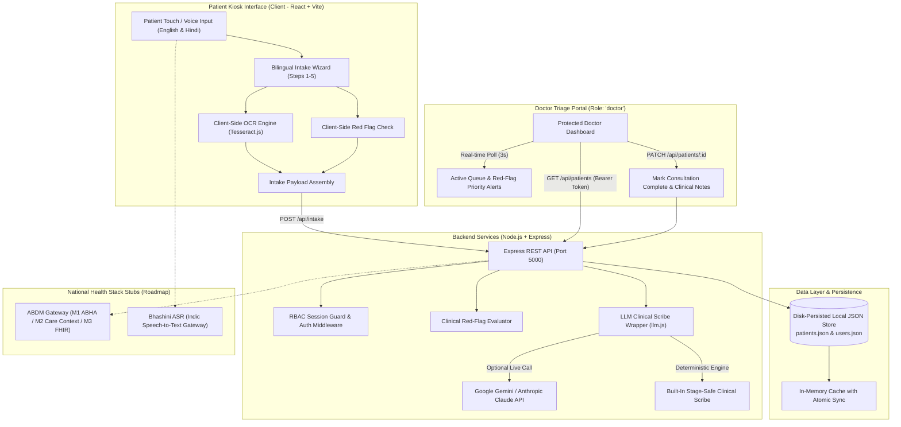

# Jeevika — AI-Powered Patient Intake Kiosk for Indian OPDs (with AYUSH support)

> **An intelligent, bilingual self-service intake kiosk and real-time clinical triage dashboard designed to eliminate OPD wait times, automate structured clinical documentation, digitize physical prescriptions client-side, and capture Ayurvedic (AYUSH) constitutional parameters for Indian hospitals.**

---

## 1. Project Title & Tagline

**Jeevika** is a full-stack, AI-powered patient intake kiosk and clinical triage system tailored specifically for Indian Outpatient Departments (OPDs), including integrated **AYUSH (Ayurveda, Yoga & Naturopathy, Unani, Siddha, and Homoeopathy)** clinics. It bridges the communication gap between patients in waiting halls and doctors in consulting rooms through touch/voice bilingual interfaces, client-side OCR prescription scanning, automated clinical summarization, and instant emergency red-flag triage.

---

## 2. Problem Statement

Indian government hospitals, AIIMS facilities, and district health centers face an overwhelming outpatient load:
- **Long Manual Intake Bottlenecks:** Patients often wait 2 to 4 hours in crowded waiting halls, only to receive a hurried 2-to-3 minute consultation where over 60% of the doctor's time is spent asking repetitive demographic and history-taking questions.
- **Lost Paper Records & Fragmented History:** Patients frequently carry crumpled, handwritten prescriptions and laboratory slips that are difficult to read, easily misplaced, and rarely digitized into a longitudinal health record.
- **AYUSH Parameters Neglected Digitally:** Despite national initiatives to integrate AYUSH into mainstream healthcare, critical Ayurvedic diagnostic parameters (*Prakriti*, *Agni*, *Koshtha*, *Dashavidha Pariksha*) are never captured in standard electronic health records.
- **Delayed Triage of Emergencies:** Critically ill patients (e.g., acute myocardial infarction/chest pain, severe dyspnea, acute hemorrhage) often sit unprioritized in general OPD queues rather than being routed directly to resuscitation or acute care bays.

---

## 3. Solution Overview

**Jeevika** transforms the OPD reception experience into a modern, streamlined digital workflow:
- **Comprehensive 13-Language Multilingual Intake:** Full native-language support for **English + 12 major Indian languages** (Hindi, Bengali, Marathi, Telugu, Tamil, Gujarati, Urdu, Kannada, Odia, Malayalam, Punjabi, Assamese) powered by `react-i18next` and dedicated per-language JSON dictionaries.
- **Native Script Language Selector & Dynamic RTL:** Native-script touch grid on landing page and header selector. Full bidirectional **Right-to-Left (RTL)** layout mirroring (`dir="rtl"`) for Urdu with Noto Nastaliq Urdu / Arabic font rendering.
- **Multilingual Voice Assistance:** Web Speech API integration with BCP-47 locale mapping (`hi-IN`, `bn-IN`, `ta-IN`, `ur-IN`, etc.) for voice dictation and read-aloud question audio prompts.
- **Immediate Urgent Care Red-Flag Interrupt:** Active interruption that stops normal intake flow immediately upon detection of critical symptoms (severe chest pain, dyspnea at rest, heavy bleeding, loss of consciousness) in any of the 13 languages, routing the patient to a dedicated high-contrast Urgent Care Notice screen with live doctor/nurse alert dispatch and staff override.
- **Holistic AYUSH Intake Module:** Seamlessly captures constitutional dosha tendencies (*Vata*, *Pitta*, *Kapha*), digestive fire (*Agni*), and bowel habit (*Koshtha*) alongside allopathic Review of Systems (ROS).
- **Client-Side Optical Character Recognition (OCR):** Using `Tesseract.js`, previous doctor prescriptions and lab reports are processed directly in the patient's browser without transferring heavy images across the network.
- **Deterministic & LLM Clinical Scribing:** Synthesizes raw patient responses and scanned text into a structured, 6-part clinical note (*Chief Complaint*, *HPI*, *Past Medical History*, *ROS*, *AYUSH Assessment*, *Flagged Concerns*).
- **Real-Time Doctor Triage Dashboard:** Doctors receive prioritized patient files in English, live queue counters, instantaneous red-flag emergency alerts, and a one-click consultation completion workflow.

---

## 4. System Architecture

### Architectural Diagram



### Data Flow Explanation

1. **Intake & Local OCR:** The patient enters demographic data, answers the clinical wizard, and uploads prior prescriptions. `Tesseract.js` executes in the browser web worker, extracting text without backend roundtrips.
2. **Transmission & Validation:** The kiosk dispatches a unified payload (`patient`, `intakeData`, `ocrData`) to `POST /api/intake`.
3. **AI Scribing & Triage:** The backend runs rule-based red-flag evaluation (detecting acute cardiac, respiratory, or hemorrhagic triggers) and calls `generateClinicalSummary()`. If an API key is present in `server/.env`, Gemini or Claude generates the note; otherwise, the built-in deterministic engine provides guaranteed, coherent clinical documentation.
4. **Persistence:** The session is committed to `server/data/patients.json` and assigned a standardized OPD token (`OPD-GEN-XXX`, `AYUSH-XXX`, or `EMERG-XXX`).
5. **Real-Time Doctor Triage:** The Doctor Dashboard polls `/api/patients` every 3 seconds using authenticated JWT/Bearer tokens. Red-flag patients are permanently pinned to the top of the queue. Completing a consultation updates the record, removes the patient from the active list, and immediately decrements the queue counters.

---

## 5. Tech Stack

| Layer | Technology | Purpose in Jeevika |
| :--- | :--- | :--- |
| **Frontend Framework** | **React 18.3.1 + Vite 5.2.11** | Single-page application with modular component architecture and sub-second HMR. |
| **Multilingual i18n** | **i18next 24.2.2 + react-i18next 15.4.1** | 13-language native translation architecture with JSON bundles, dynamic RTL switching, and Google Noto Indic fonts. |
| **Styling & Icons** | **Tailwind CSS 3.4.3 + Lucide React 0.378** | Responsive, accessible dark-mode UI with medical triage color coding, RTL support, and micro-animations. |
| **Micro-Interactions** | **canvas-confetti 1.9.3** | Interactive feedback upon successful token issuance and check-in completion. |
| **Client-Side OCR** | **Tesseract.js 5.1.0** | In-browser optical character recognition for digitizing paper prescriptions and lab slips. |
| **Voice & Speech** | **Web Speech API** (`SpeechRecognition` & `SpeechSynthesis`) | Hands-free dictation with 13-language BCP-47 locale mapping (`hi-IN`, `bn-IN`, `ta-IN`, `ur-IN`, etc.); read-aloud question audio prompts. |
| **Backend Framework** | **Node.js (ESM) + Express 4.19.2** | High-performance RESTful API exposing intake, auth, patient records, and live stats. |
| **Data Persistence** | **Disk-Persisted Local JSON Store** (`patients.json`, `users.json`) | Zero-cloud-dependency database with atomic file sync and in-memory caching (architected for Firestore/PostgreSQL in production). |
| **Authentication & RBAC** | **Token-Based Session Auth** | Strict role-based access control protecting clinical records with `requireDoctorOrStaff` middleware. |
| **AI Clinical Scribe** | **Google Gemini 1.5 Flash / Anthropic Claude 3.5 Sonnet** | Automated transformation of unstructured symptom inputs and OCR text into 6-part clinical documentation (with deterministic fallback). |
| **Real-Time Updates** | **High-Efficiency HTTP Polling (3s)** | Live queue synchronization, real-time alert badge counters, and instant consultation state transitions. |

---

## 6. Workflow Pipeline

```
 ┌─────────────────────────┐
 │ 1. Staff/Patient Auth   │  Dual-path entry: ABHA/Guest for Kiosk vs Username/Password for Staff
 └───────────┬─────────────┘
             │
 ┌───────────▼─────────────┐
 │ 2. Bilingual Intake     │  Chief Complaint → HPI → Past Medical History → ROS → AYUSH Module
 └───────────┬─────────────┘
             │
 ┌───────────▼─────────────┐
 │ 3. Prescription OCR     │  Client-side Tesseract.js digitizes prior Rx, meds, and lab values
 └───────────┬─────────────┘
             │
 ┌───────────▼─────────────┐
 │ 4. Red-Flag Evaluation  │  Instant screening for ACS/chest pain, respiratory failure, hemorrhage
 └───────────┬─────────────┘
             │
 ┌───────────▼─────────────┐
 │ 5. AI Clinical Scribe   │  Generates 6-part standardized note (LLM or deterministic fallback)
 └───────────┬─────────────┘
             │
 ┌───────────▼─────────────┐
 │ 6. Token Slip Issued    │  Physical token generated (OPD-GEN / AYUSH / EMERG) with print support
 └───────────┬─────────────┘
             │
 ┌───────────▼─────────────┐
 │ 7. Doctor Consultation  │  Live queue view, raw intake audit, doctor notes, and 1-click complete
 └─────────────────────────┘
```

1. **Staff / Patient Login (RBAC):** Patients select 1-click ABHA check-in or guest walk-in. Hospital staff log in via password-protected credentials.
2. **Patient Intake Flow:** Touch or speak symptoms across 5 structured steps:
   - *Step 1: Chief Complaint* (with quick-select high-frequency chips in EN/HI).
   - *Step 2: History of Present Illness (HPI)* (duration, 1-10 severity slider, associated symptoms).
   - *Step 3: Past History* (chronic illnesses, allergies, active medications).
   - *Step 4: Review of Systems (ROS)* (cardiac, respiratory, gastrointestinal, neurological, musculoskeletal).
   - *Step 5: AYUSH Assessment* (Prakriti, Agni, Koshtha, Bala, Satmya, Nidra).
3. **Document Scan & OCR Extraction:** Patient captures or uploads prior prescriptions; `Tesseract.js` extracts drug names and dosages client-side.
4. **Red-Flag Detection:** Critical symptoms trigger a crimson emergency banner immediately, alerting nursing staff and assigning an `EMERG-XXX` priority token.
5. **AI Clinical Summary Generation:** Intake data is transformed into a structured 6-part clinical note before the patient reaches the consulting room.
6. **Token Slip Issuance:** The patient receives an OPD slip with a scannable token and QR representation, ready for physical printing.
7. **Doctor Review & Completion:** The clinician reviews the AI note, OCR text, and raw audit log, enters consultation advice, and marks the visit complete. The live queue immediately shrinks and metrics decrement in real time.

---

## 7. Key Features

- 🔒 **Strict Role-Based Access Control (RBAC):** Complete bidirectional portal isolation. Doctors cannot access the patient self-service kiosk; patients cannot access the doctor clinical queue. Backend endpoints return `401 Unauthorized` or `403 Forbidden` if unauthorized.
- ⚡ **Live Real-Time Doctor Dashboard:** Active patient queue synchronized every 3 seconds. Pinned emergency red-flag cases appear at the top with animated visual alerts.
- 🌿 **Integrated AYUSH (Ayurveda) Assessment:** Native support for Indian traditional medicine parameters (*Vata/Pitta/Kapha* Dosha, *Mandagni/Tikshnagni*, *Krura/Mridu Koshtha*).
- 📷 **In-Browser OCR Document Scanner:** Digitizes physical prescriptions, doctor notes, and lab reports using Web Workers without uploading images to third-party servers.
- 🤖 **Automated 6-Part Clinical Scribe:** Produces standard medical notes (*Chief Complaint, HPI, Past History, ROS, AYUSH, Flagged Concerns*) via Gemini/Claude or zero-dependency clinical logic.
- 🚨 **Instant Emergency Red-Flag Triage:** Rules-based early detection for acute chest pain, respiratory distress, and stroke symptoms, immediately notifying the triage desk.
- 🌐 **Bilingual Accessibility (English & Hindi):** Complete clinical dictionary translation and voice synthesis for low-literacy or elderly citizens.

---

## 8. Setup & Installation

### Prerequisites
- **Node.js**: v18.0.0 or higher
- **npm**: v9.0.0 or higher
- Modern web browser (Chrome, Edge, Firefox, or Safari) with Web Speech API support

### Step-by-Step Installation

```bash
# 1. Clone the repository
git clone https://github.com/your-username/MediKiosk.git
cd MediKiosk

# 2. Install backend dependencies
cd server
npm install

# 3. Install frontend dependencies
cd ../client
npm install
```

### Environment Configuration (Optional)

The system includes a **built-in deterministic medical NLP engine** that produces realistic, coherent clinical summaries without any external API keys (ensuring zero failure during hackathon demonstrations).

To enable live Gemini or Claude generation, configure `server/.env`:

```bash
# In server/.env
PORT=5000

# Optional: Add your Google Gemini API Key
GEMINI_API_KEY=your_gemini_api_key_here

# Optional: Or add your Anthropic Claude API Key
# ANTHROPIC_API_KEY=your_anthropic_api_key_here
```

### Running Locally

Open two terminal windows:

#### Terminal 1: Backend Server (Port 5000)
```bash
cd server
npm start
# Server will run on http://127.0.0.1:5000
```

#### Terminal 2: Frontend Client (Port 5173)
```bash
cd client
npm run dev
# Frontend will run on http://localhost:5173 (bound to 0.0.0.0)
```

Open your browser and navigate to:
👉 **[http://localhost:5173](http://localhost:5173)**

---

## 9. Demo Credentials

The database comes pre-seeded with realistic Indian OPD patient cases and authenticated staff accounts:

### Staff Portal Accounts
| Role | Username | Password | Staff Member & Department |
| :--- | :--- | :--- | :--- |
| **Doctor** | `doctor1` | `password123` | **Dr. A. K. Sen** (Chief OPD Consultant & Cardiologist) |
| **Doctor** | `doctor2` | `password123` | **Dr. Priya Sharma** (Senior Ayurvedic Vaidya, AYUSH) |
| **Nurse** | `nurse1` | `password123` | **Sister Mary Joseph** (Triage Nurse Lead) |

### Patient Portal Access
- **Verified ABHA ID (1-Click):** Click *"Login with Demo ABHA ID"* (`14-5521-9874-3210`, Ramesh Kumar, 58/M).
- **Custom ABHA ID:** Enter any standard 14-digit ABHA ID format (e.g., `14-9988-7766-5544`).
- **Walk-in / Guest Mode:** Click *"Continue without ABHA (Guest Walk-in)"* for anonymous check-in.

---

## 10. Future Scope & Roadmap

| Area | Status in Current Demo | Production Roadmap |
| :--- | :--- | :--- |
| **ABDM Integration** | Architected & Documented Stubs (M1, M2, M3) | Live integration with the National Health Authority (NHA) ABDM Gateway for Aadhaar OTP verification, Care Context linking, and consent-driven FHIR bundle exchanges. |
| **Indic Voice AI (ASR)** | Browser Web Speech API | Direct integration with **Bhashini / AI4Bharat** APIs to support voice input across all 22 scheduled Indian languages, including regional dialects. |
| **Hospital HIS / EHR** | Standalone REST API with JSON persistence | HL7 FHIR standard connector syncing patient records directly into enterprise hospital information systems (Epic, Cerner, NIC e-Hospital). |
| **Hardware Peripherals** | Virtual QR & Browser Print Dialog | Native integration with physical thermal receipt printers, USB barcode/QR scanners, and IoT Bluetooth pulse oximeter / BP monitors. |
| **Nurse Triage Station** | Stubbed Staff Role | Dedicated triage bay dashboard allowing nurses to take pre-consult vitals (BP, SpO2, Pulse, Temp) and perform preliminary ECGs. |

---

## 11. Team & Hackathon Information

- **Hackathon:** *[Insert Hackathon Name / Track Here]*
- **Project Name:** Jeevika
- **Submission Date:** September 2026
- **Team Name:** *[Insert Team Name]*
- **Team Members:**
  - *[Member 1 Name - Role / Contribution]*
  - *[Member 2 Name - Role / Contribution]*
  - *[Member 3 Name - Role / Contribution]*
- **Repository:** *[Insert GitHub Repository Link]*
- **Video Demo:** *[Insert Video / Loom / YouTube Link]*

---

*Jeevika © 2026 • AI-Assisted Patient Intake & Priority Triage for Indian Hospital OPDs*

